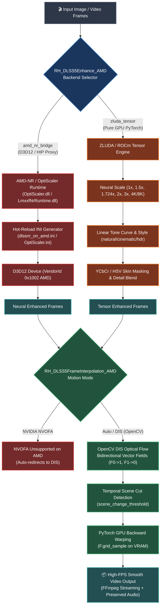
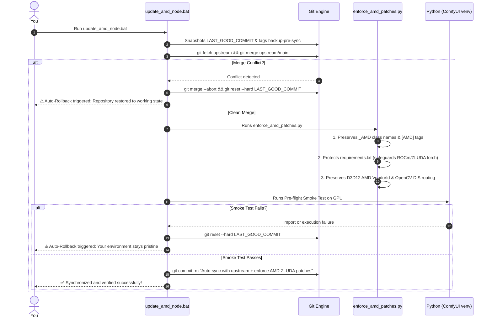

<div align="center">

# ⚡ ComfyUI-RH-DLSS5-AMD
### DLSS 5 Neural Rendering (Upscale & Enhance) + Temporal Frame Generation for AMD Radeon GPUs on Windows

[](https://github.com/Speedstu/CUDA-for-AMD-Windows)
[-76B900?style=for-the-badge&logo=nvidia&logoColor=white)](https://github.com/RH-RunningHub/ComfyUI-RH-DLSS5)
[](https://github.com/3zwr1/AMD-NR---OptiScaler)
[](https://github.com/comfyanonymous/ComfyUI)
[](https://www.python.org/)
[](https://microsoft.com/windows)
[](https://paypal.me/mnecstream)
[](LICENSE)

<p align="center">
  <b>The first production-ready, hybrid architecture bringing NVIDIA DLSS 5 Neural Rendering (Feature 18) and high-framerate temporal Frame Generation to AMD Radeon graphics cards on Windows via ZLUDA, AMD HIP, and OpenCV DIS.</b>
</p>

[Why This Fork Exists](#-the-technical-story-why-does-this-fork-even-exist) •
[Architecture](#-pipeline-architecture) •
[Auto-Updater](#-auto-update-system--amd-shielding) •
[Setup & Runtimes](#-runtime-setup--installation) •
[Workflow](#-ready-to-use-workflow) •
[Troubleshooting](#-troubleshooting--pro-tips) •
[Support](#-support-this-project--buy-me-a-coffee) •
[Credits & Licenses](#-licenses--shoutouts)

---

</div>

## 📖 The Technical Story: Why does this fork even exist?

NVIDIA's **DLSS 5 Neural Rendering (Feature 18)** is a massive leap forward in image reconstruction, micro-structure preservation, and real-time upscaling. The upstream project [`RH-RunningHub/ComfyUI-RH-DLSS5`](https://github.com/RH-RunningHub/ComfyUI-RH-DLSS5) did amazing work building low-latency D3D12 streaming bridges and frame generation pipelines for ComfyUI.

However, upstream was built **exclusively for NVIDIA RTX hardware**:
1. **Missing DriverStore NGX Core:** On AMD GPUs, NVIDIA's proprietary `_nvngx.dll` does not exist in `DriverStore\FileRepository`. The native C++ bridge aborted on startup with `Could not find _nvngx.dll`.
2. **Missing Optical Flow Hardware (NVOFA):** Upstream frame generation depends on NVIDIA's proprietary hardware accelerator (`nvof`). On AMD GPUs, attempting to interpolate frames threw fatal errors due to missing NVOFA contexts.
3. **Hardware Vendor Lockout:** The native D3D12 device discovery rejected any adapter whose `VendorId != 0x10DE` (NVIDIA), completely locking out AMD Radeon hardware (`0x1002`).

### How this fork solves every hurdle:

This fork bridges the gap by uniting modern community D3D12/HIP translation runtimes with a high-performance pure-PyTorch GPU engine:

- 🎮 **Dual-Engine Neural Rendering (`RH_DLSS5Enhance_AMD`):**
  - **`amd_nr_bridge` Mode:** Enables direct D3D12/HIP translation using community shims ([`3zwr1/AMD-NR---OptiScaler`](https://github.com/3zwr1/AMD-NR---OptiScaler), [`danielblnc/DLSS-NR-on-AMD`](https://github.com/danielblnc/DLSS-NR-on-AMD), and `LmxxfNrRuntime`). The bridge accepts AMD adapters (`0x1002`), auto-discovers proxy runtimes, and writes real-time hot-reload configurations to `dlssnr_on_amd.ini` and `OptiScaler.ini` (`[DlssNr]`).
  - **`zluda_tensor` Mode (100% Out-of-the-Box Fallback):** No external DLLs needed! A pure PyTorch GPU-accelerated tensor pipeline executing natively on AMD hardware via ZLUDA / ROCm. It respects every single node parameter:
    - **Scaling Modes:** `1x (DLAA)`, `1.5x (Quality)`, `1.724x (Balanced)`, `2x (Performance)`, `3x (Ultra Performance)`, and bucketed targets (`1K`, `2K`, `4K`, `8K`).
    - **Micro-Structure & Frequency Enhancement:** Preserves delicate high frequencies without ringing artifacts (`structure`).
    - **Linear Light Color Grading:** Color-accurate tone curves across `default`, `natural`, and `cinematic` styles, HDR tone expansion, and global exposure adjustments (`global_tone`, `tone`, `hdr`).
    - **YCbCr/HSV Skin Tone Protection:** Automatic facial and skin region segmentation with smooth alpha masking (`skin`, `auto_mask`).
- ⚡ **Temporal Frame Generation without NVOFA (`RH_DLSS5FrameInterpolation_AMD`):**
  - Seamlessly replaces NVIDIA's hardware optical flow with **OpenCV DIS (Dense Inverse Search)** optical flow.
  - Generates bidirectional motion fields ($F_{0 \to 1}$ and $F_{1 \to 0}$) with occlusion masking and executes sub-pixel backward warping directly on AMD GPU VRAM using PyTorch `grid_sample`.
  - Supports 2x, 3x, 4x, 6x multipliers or arbitrary target frame rates (`output_fps`), scene change cut detection (`scene_change_threshold`), and bounded-memory FFmpeg streaming with audio preservation.
- 🛡️ **Zero-Collision Isolation (`_AMD` / `[AMD]`):**
  - All class mappings (`RH_DLSS5Enhance_AMD`, `RH_DLSS5FrameInterpolation_AMD`) and UI display titles include `[AMD]` to allow conflict-free coexistence alongside upstream nodes.
- 🔄 **Self-Maintaining Upstream Updater & Auto-Rollback:**
  - Update effortlessly with `update_amd_node.bat`. If an upstream change introduces syntax errors or breaks compatibility, the updater triggers an automatic rollback (`git reset --hard`) to ensure your installation never breaks.

---

## 📊 Quick Comparison

| Feature | Upstream (ComfyUI-RH-DLSS5) | **ComfyUI-RH-DLSS5-AMD (This Fork)** |
| :--- | :---: | :---: |
| **NVIDIA RTX Support** | ✅ Native D3D12 | ✅ Fully Preserved |
| **AMD Radeon Support (Windows)** | ❌ *Hardware Lockout* | ✅ **Full Support (ZLUDA / ROCm / AMD HIP)** |
| **DLSS 5 Neural Rendering Bridge** | NVIDIA RTX Only | ✅ **D3D12/HIP Proxy (`OptiScaler` / `danielblnc`)** |
| **Zero-DLL Fallback Engine** | ❌ None (Aborts) | ✅ **`zluda_tensor` Pure PyTorch GPU Pipeline** |
| **Optical Flow / Frame Generation** | ⚠️ *NVOFA Only* | ✅ **OpenCV DIS + PyTorch GPU Warping** |
| **Node Naming & Workflow Safety** | Default | ✅ **Isolated `_AMD` & `[AMD]` Categories** |
| **Auto-Sync & Auto-Rollback** | ❌ Manual | ✅ **`update_amd_node.bat` Idempotent Engine** |

---

## 🏗️ Pipeline Architecture



---

## 🔄 Auto-Update System & AMD Shielding

Keeping up with upstream changes shouldn't mean re-applying your AMD patches by hand every time. This fork includes an intelligent, idempotent synchronization and shielding system:



### Updating in One Step:
Simply double-click:
```bat
update_amd_node.bat
```
Or execute from PowerShell / command prompt:
```powershell
<COMFYUI_PYTHON> update_from_upstream.py
```

---

## 📥 Runtime Setup & Installation

### 1. Requirements
- **Windows 11 (64-bit)**
- **AMD Radeon GPU:** RX 6000, 7000, 8000, 9000 series, or Radeon AI PRO (e.g. R9700).
- **ZLUDA Layer:** Installed and active via [`Speedstu/CUDA-for-AMD-Windows`](https://github.com/Speedstu/CUDA-for-AMD-Windows).
- **ComfyUI Virtual Environment:** With PyTorch built for ROCm/ZLUDA.

> [!CAUTION]
> **Do not run `pip install torch`!** This repository protects your existing ROCm/ZLUDA PyTorch build. Only install auxiliary packages:
> ```powershell
> <COMFYUI_PYTHON> -m pip install numpy opencv-python
> ```

### 2. Clone into ComfyUI Custom Nodes
In your ComfyUI custom nodes directory:
```bash
cd <COMFYUI_ROOT>/custom_nodes
git clone https://github.com/mnector/ComfyUI-RH-DLSS5-AMD.git
```

### 3. Understanding Backend Runtimes (License Compliance)

> [!IMPORTANT]
> **Licensing Notice:** Neither NVIDIA's proprietary DLLs (`nvngx_dlssnr.dll`) nor community binaries (`danielblnc/DLSS-NR-on-AMD`) permit redistribution in third-party git repositories.
> 
> You have two simple ways to run this custom node:
> 
> 1. **Zero External Files (`zluda_tensor` mode):**  
>    Works **immediately** after cloning! The pure PyTorch tensor engine runs directly on your AMD GPU via ZLUDA with zero setup required.
> 
> 2. **Hardware D3D12/HIP Bridge (`amd_nr_bridge` mode):**  
>    Download the runtime files directly from the original creators:
>    - Download the runtime release from [danielblnc/DLSS-NR-on-AMD](https://github.com/danielblnc/DLSS-NR-on-AMD) or [3zwr1/AMD-NR---OptiScaler](https://github.com/3zwr1/AMD-NR---OptiScaler).
>    - Place the extracted files into `<COMFYUI_ROOT>/models/dlss5/`.

### 4. Automated Runtime Diagnostic
Run our diagnostic helper at any time to inspect your runtime folder:
```powershell
<COMFYUI_PYTHON> setup_amd_runtime.py
```
It will display the status of each component and guide you if anything is missing:
```
======================================================================
 ComfyUI-RH-DLSS5-AMD: Runtime Setup & Diagnostics
======================================================================
[*] ComfyUI Models Target: <COMFYUI_ROOT>/models/dlss5
[*] Architecture: AMD Radeon GPU on Windows (ZLUDA / ROCm)

[+] Runtime folder exists and is ready for use.
[i] zluda_tensor fallback: 100% functional out-of-the-box!
======================================================================
```

---

## 🎨 Ready-to-Use Workflow

We provide a complete, pre-configured workflow located at:
📁 **[`examples/workflow_dlss5_amd.json`](examples/workflow_dlss5_amd.json)**

### How to use:
1. Open ComfyUI in your browser.
2. Drag and drop `examples/workflow_dlss5_amd.json` onto the canvas.
3. The workflow connects:
   - **`RH_DLSS5Enhance_AMD`:** Set `amd_backend` to `auto` (or `zluda_tensor`). Adjust `upscaling_mode`, `style` (*default*, *natural*, *cinematic*), and `structure`.
   - **`RH_DLSS5FrameInterpolation_AMD`:** Set `output_fps` to `2x`, `3x`, or custom target FPS. Motion is automatically handled by OpenCV DIS optical flow with high fidelity.

---

## 🛠️ Troubleshooting & Pro Tips

<details>
<summary><b>🔧 1. Recommended ZLUDA startup flags</b></summary>

When running intensive Neural Rendering or Frame Interpolation pipelines under ZLUDA, enable dynamic VRAM and disable smart memory swapping for optimal latency and memory stability:
```bat
@echo off
set ZLUDA_ENABLE_DYNAMIC_VRAM=1
set HIP_VISIBLE_DEVICES=0
python main.py --disable-smart-memory --highvram
```
`--disable-smart-memory` prevents aggressive system RAM swapping across the translation layer.
</details>

<details>
<summary><b>🔧 2. Choosing between amd_nr_bridge and zluda_tensor</b></summary>

- **`auto` (Recommended):** Detects if the D3D12/HIP runtime files are present in `ComfyUI/models/dlss5/`. If present, it launches `amd_nr_bridge`. If not, it falls back transparently to `zluda_tensor`.
- **`zluda_tensor`:** Always forces pure PyTorch GPU tensor execution. Ideal for zero-dependency setups or debugging.
- **`amd_nr_bridge`:** Forces execution through the D3D12 proxy bridge (`OptiScaler` / `danielblnc` / `LmxxfNrRuntime`).
</details>

<details>
<summary><b>🔧 3. Optical Flow Performance on AMD</b></summary>

In `RH_DLSS5FrameInterpolation_AMD`, `motion="auto"` automatically selects OpenCV DIS optical flow on AMD GPUs. OpenCV DIS runs ultra-fast gradient-descent inverse composition. If you notice artifacts around fast cuts, adjust `scene_change_threshold` (default `0.24`) to trigger scene-cut protection.
</details>

---

## ☕ Support This Project / Buy Me a Coffee

Bringing cutting-edge AI technologies designed exclusively for NVIDIA hardware over to AMD Radeon graphics cards under Windows takes immense reverse-engineering, C++ bridge tuning, and persistent debugging.

If this project saved you hours of troubleshooting, gave your Radeon GPU new superpowers, or improved your ComfyUI workflow, consider buying me a coffee to support continued development and updates!

<div align="center">

<a href="https://paypal.me/mnecstream" target="_blank">
  
</a>

<p>
  <b>Every contribution helps keep this repository actively maintained and tested!</b><br/>
  👉 <a href="https://paypal.me/mnecstream">paypal.me/mnecstream</a>
</p>

</div>

---

## 🤝 Licenses & Shoutouts

This project is built upon the incredible work of researchers and open-source pioneers across the community:

- **[RH-RunningHub](https://github.com/RH-RunningHub/ComfyUI-RH-DLSS5):** Original creators of `ComfyUI-RH-DLSS5` (released under the MIT License).
- **[danielblnc (Daniel Blanco)](https://github.com/danielblnc/DLSS-NR-on-AMD):** Author of the groundbreaking AMD HIP native kernel implementation for DLSS-NR on Radeon GPUs.
- **[3zwr1](https://github.com/3zwr1/AMD-NR---OptiScaler) & [lmxxf](https://github.com/lmxxf/dlss5-on-amd-9070xt-porting):** Authors of the `AMD-NR---OptiScaler` bridge and D3D12 porting layer.
- **[Speedstu](https://github.com/Speedstu/CUDA-for-AMD-Windows) & the ZLUDA project:** For making CUDA/HIP acceleration viable on AMD GPUs in Windows.

---

<div align="center">
  <b>ComfyUI-RH-DLSS5-AMD</b> • Crafted with passion for the open AMD AI community.
</div>
